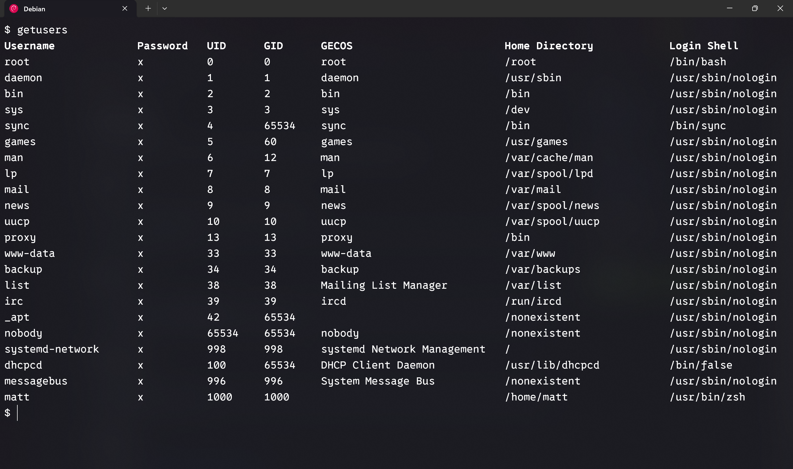

# GetUsers
Simple utility script for checking the users on Linux and nicely formatting /etc/passwd.

    

    <strong>POSIX Compliant Information Gathering Tool</strong>

## Usage:
Gets a list of all users based on usernames in /etc/passwd

    ./getusers.sh [OPTIONS]...

## Options:
    -h, --help      Print help menu
    -o <filepath>   Specify an output file (Optional)

## Examples:
    ./getusers.sh
    ./getusers.sh -o users.txt

## Authors:
L3prech4un - https://github.com/L3prech4un
**Currently a work in progress but I plan to expand more on this at a later date**
